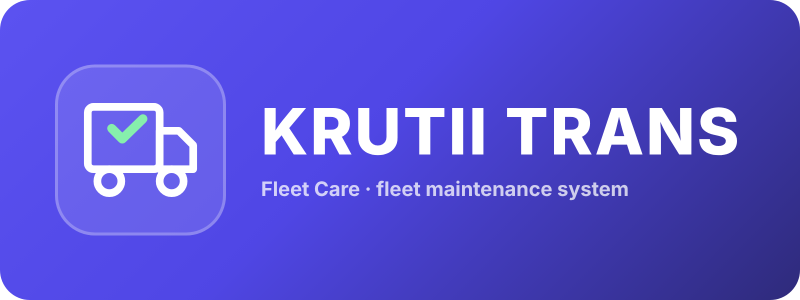
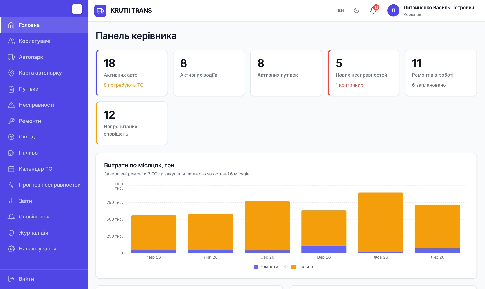
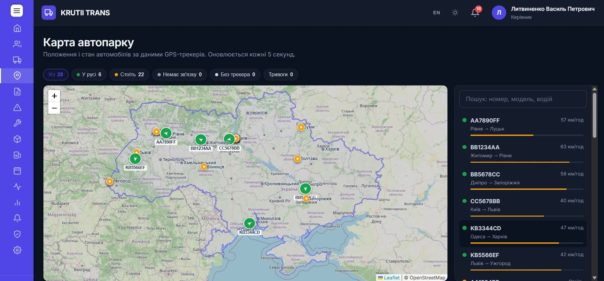
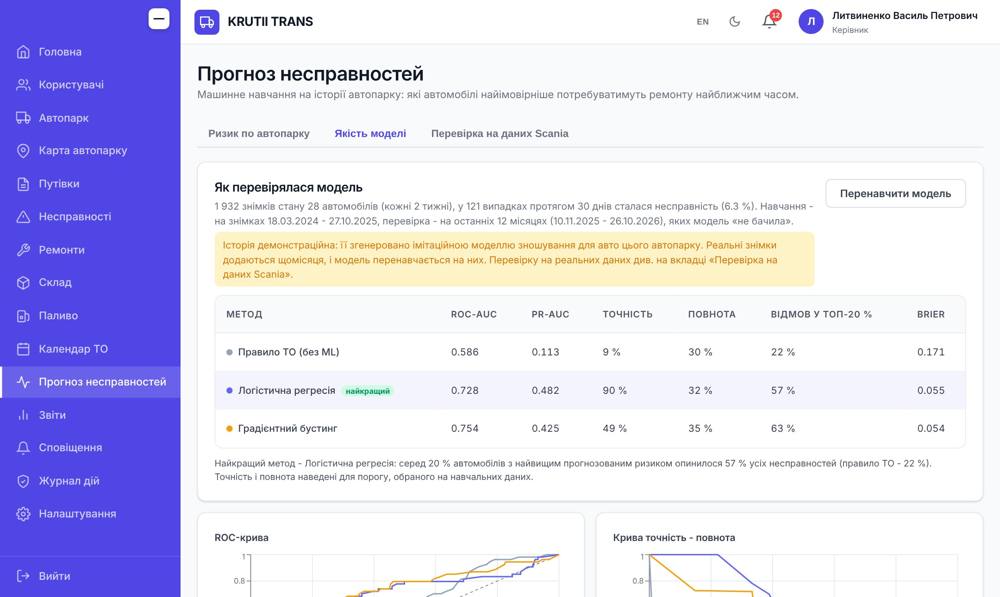
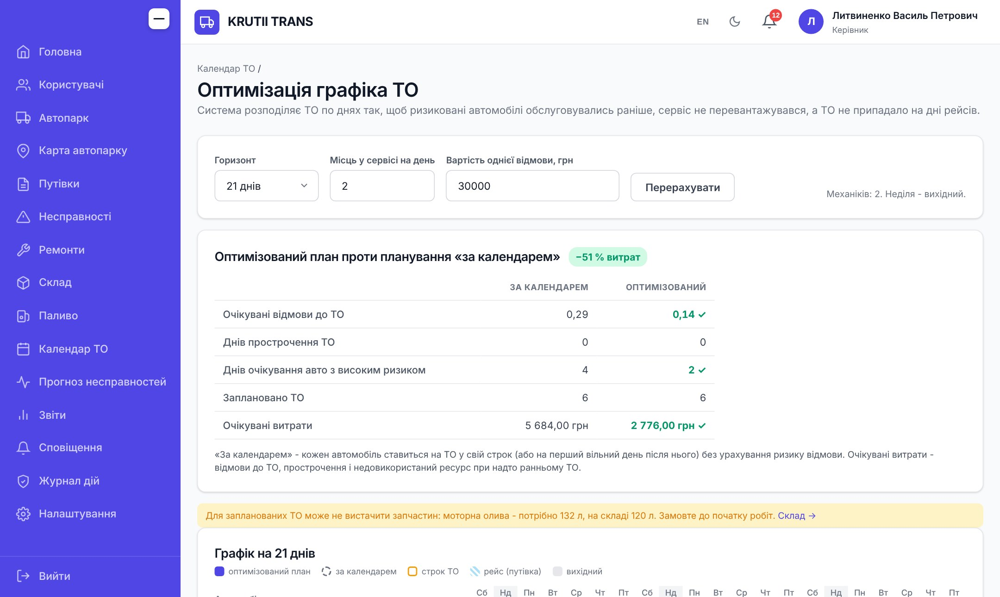
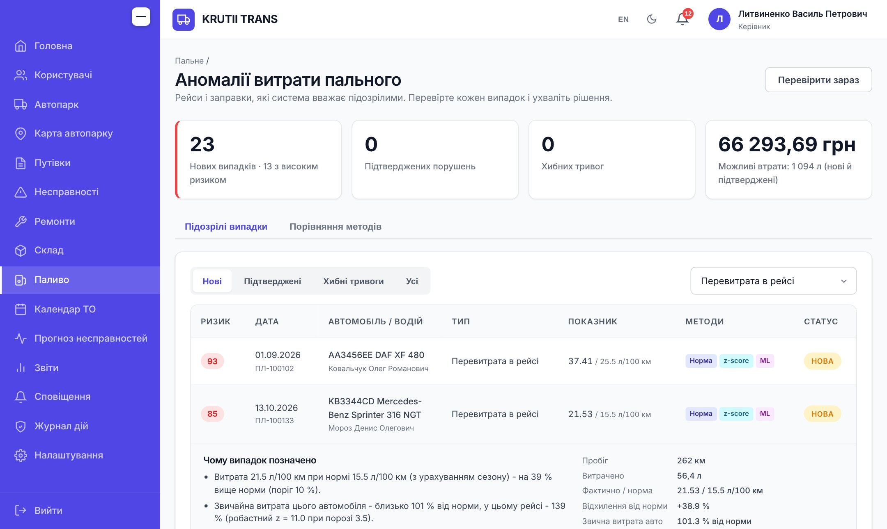

<p align="center">
  
</p>

# KRUTII TRANS

Fleet maintenance management system for a logistics company.

Besides waybills, fuel, faults and repairs, the system analyses fleet data: it detects suspicious fuel consumption, predicts failures with machine learning, optimizes the maintenance schedule and shows vehicles on a live map using GPS tracker data (telematics).

<p align="center">
  
  
</p>

## Technologies

- **Backend:** Flask, PyMongo, JWT, APScheduler, Marshmallow, Flask-Limiter
- **Analytics & ML:** scikit-learn (Isolation Forest, logistic regression, gradient boosting), SciPy (Hungarian algorithm), NumPy
- **Documents:** ReportLab (PDF waybills with a QR code, DejaVu fonts with Cyrillic support)
- **Frontend:** React 18, Zustand, Recharts, Vite, React Router, Leaflet + OpenStreetMap
- **Database:** MongoDB
- **Tests:** pytest (separate test database `krutii_test`)
- **UI:** Custom design system with glassmorphism effects, light and dark themes, Ukrainian and English interface

## Features

### Manager
- Complete user and fleet management
- Creation and control of waybills, printing and downloading a waybill as PDF with a QR code
- Fuel invoices and expense analytics
- **Fuel consumption anomalies:** suspicious trips and refuels, "confirmed / false alarm" decisions, comparison of detection methods
- **Failure prediction (ML):** 30-day failure risk for every vehicle, model quality, validation on real Scania data
- **Maintenance schedule optimization:** a 2-4 week maintenance plan that accounts for risk, trips and workshop capacity
- **Fleet map:** live position, speed, fuel, engine temperature and error codes
- **Activity log:** who changed what and when, with Excel export
- Reports on expenses, maintenance (ТО), and efficiency; dashboard charts; Excel export
- Parts warehouse: stock, receipts, movements, low-stock alerts
- System settings (fuel norms, categories)

### Mechanic
- Handling fault reports from drivers
- Planning and performing repairs with parts written off from the warehouse
- Maintenance schedule control, maintenance calendar
- History of each vehicle ("medical record"): waybills, faults, repairs, refuels
- Failure risk and predicted maintenance date on the vehicle card
- Fleet map and telematics signals (overheating, voltage, error codes)
- Instant notifications about new faults

### Driver
- Viewing active waybills, printable PDF waybill
- Fault reports with photos
- Tracking refuelings along the route
- Completing waybills with mileage tracking

### All roles
- Sign-in with a password or **with a 4-digit code sent by email** (Gmail)
- Profile: own contact details and password change
- Language switch (Ukrainian / English), including on the sign-in page
- Light and dark themes, collapsible sidebar
- Company contact dock (social networks, email)

<p align="center">
  
  
</p>

## Installation

### Prerequisites
- Python 3.11+
- Node.js 18+
- MongoDB 6+

### Quick start (Windows)

Run `start.bat` in the `Krutii_Trans` folder. The script checks MongoDB, creates the virtual environment, installs dependencies, fills the database with demo data on the first run and opens three windows: **Backend**, **Frontend** and **Simulator**. In the Simulator window press `1` to start the telematics simulator (cars on the map) or `2` to close it.

### Backend

```bash
cd backend
python -m venv venv
venv\Scripts\activate  # Windows
source venv/bin/activate  # Linux/Mac
pip install -r requirements.txt
python seed.py  # Initialize demo data
python app.py   # Server at http://localhost:5001
```

### Frontend

```bash
cd frontend
npm install
npm run dev
```

The application will be available at http://localhost:5173

### Email code sign-in (optional)

To send sign-in codes to a real mailbox, copy `backend/.env.example` to `backend/.env` and set a Gmail address and an app password (16 characters, created in the Google account settings with 2-Step Verification enabled). Without it the system runs in demo mode: the code is printed in the Backend window. The `.env` file is never committed.

### Telematics simulator

The simulator imitates the fleet's GPS trackers: vehicles with active waybills drive along Ukrainian highways and refuel, and from time to time breakdowns and violations happen (overheating, an error code, a flat battery, a fuel drain, driving without a waybill). Start it from `start.bat` or separately while the Backend is running:

```bash
cd backend
venv\Scripts\python.exe simulator.py                      # Windows
python simulator.py --incident-every 20                   # more frequent incidents (for demos)
python simulator.py --no-incidents --speed 60             # no incidents, faster
```

A real tracker connects the same way: the manager issues a key on the fleet map, and the tracker sends data to `POST /api/telematics/ingest` with the `X-Device-Key` header.

### Model validation on Scania data (optional)

The ready report is in `backend/assets/ml/scania_report.json`. To recompute it (the script downloads a ~56 MB dataset and runs for a few minutes):

```bash
cd backend
venv\Scripts\python.exe -m ml.scania_validate
```

## Demo Accounts

| Role    | Login         | Password  |
|---------|---------------|-----------|
| Manager | admin         | Admin1234 |
| Mechanic| mech_koval    | Mech1234  |
| Driver  | driver_ivanov | Driver1234|

## Project Structure

```
/backend
  app.py              # Flask entry point
  config.py           # Configuration (MongoDB, JWT, rate limits, email)
  seed.py             # Demo data
  simulator.py        # GPS tracker simulator (telematics)
  .env.example        # Email settings template
  /routes             # API endpoints
    auth.py           # Authentication (password, email code, profile)
    users.py          # Users
    vehicles.py       # Fleet
    waybills.py       # Waybills (+ PDF)
    faults.py         # Faults
    repairs.py        # Repairs
    fuel.py           # Fuel
    fuel_anomalies.py # Fuel consumption anomalies
    parts.py          # Parts warehouse
    alerts.py         # Alerts
    reports.py        # Reports, analytics, maintenance calendar
    settings.py       # Settings
    audit.py          # Activity log
    predictive.py     # Failure prediction (ML)
    maintenance_plan.py # Maintenance schedule optimization
    telematics.py     # Telematics: tracker data intake, map
  /models             # Marshmallow schemas
  /services
    fuel_analyzer.py  # Fuel overconsumption analysis
    fuel_anomalies.py # Anomaly detection: rule, z-score, Isolation Forest
    alert_engine.py   # Alert and escalation system, background jobs
    doc_generator.py  # Document numbering generation
    maintenance_forecast.py   # Maintenance date forecast by mileage
    predictive_maintenance.py # ML failure risk model
    ml_metrics.py     # Model quality metrics
    maintenance_optimizer.py  # Maintenance schedule optimization (Hungarian algorithm)
    telematics.py     # Telematics rules
    geo_ukraine.py    # Ukrainian cities and highways for routes
    waybill_pdf.py    # PDF waybill
    audit.py          # Activity log recording
    inventory.py      # Warehouse parts movements
    login_codes.py, mailer.py # Sign-in codes and email sending
  /ml
    scania_validate.py # Method validation on the Scania APS dataset
  /assets             # PDF fonts, Scania report
  /middleware
    auth_middleware.py # JWT authorization and roles
  /tests              # Automated tests (pytest)

/frontend/src
  /api                # Axios clients with interceptors
  /store              # Zustand stores (auth, alerts, theme, sidebar)
  /layouts            # Role-based layouts
  /i18n               # Interface translation (Ukrainian / English)
  /pages
    /driver           # Driver pages
    /mechanic         # Mechanic pages
    /manager          # Manager pages
    /shared           # Shared pages (fleet map, maintenance calendar, warehouse)
  /components         # UI components (DataTable, StatusBadge, AlertBell, SideBar)
  /utils              # Formatters, calculators, Excel export
  /styles             # CSS with design system

/docs                 # Logos and screenshots
```

## Key Features

### Authentication
- JWT tokens in httpOnly cookies
- Automatic refresh on session expiration
- Rate limiting on login (10 req/min) and on email code requests (5 req/min)
- Email code sign-in: the code is valid for 5 minutes, at most 5 attempts, resend after 30 seconds
- 5 failed sign-in attempts within 15 minutes trigger a critical alert to the manager

### Fuel Consumption Formula
```
fuel_recommended = (distance_km / 100) * fuel_norm * season_coefficient
season_coefficient = 1.0 (summer) | 1.09 (winter: November–March)
```

### Alert System
- Fault escalation: 4 hours to mechanic, 24 hours to manager
- Maintenance warnings: 1,000 km or 14 days prior
- Low stock of parts in the warehouse
- Suspicious fuel consumption (daily at 8:10 and after every completed waybill)
- High failure risk according to the ML forecast (daily at 8:20)
- Telematics events: engine overheating, low voltage, error codes, fuel drain, driving without a waybill
- Real-time push notifications

### Document Numbering
- ПЛ-XXXXXX - Waybills
- НС-XXXXXX - Faults
- РМ-XXXXXX - Repairs
- НП-XXXXXX - Fuel invoices

### Activity Log
- Every data change is recorded automatically: who, when, from which address and what exactly changed ("before → after")
- Records cannot be changed or deleted through the API; they are kept for 365 days
- Filters by user, category, status and dates, Excel export

### PDF Waybill
- The waybill is generated on the server (ReportLab) as an A4 page with a QR code
- The QR code opens the waybill page in the system (`/w/<id>`)
- Printing and download with an animation; times are shown in the local time zone

### Fuel Consumption Anomalies
Every completed trip is checked by three methods, and refuels by formal rules:
- **norm rule** - consumption above the season-adjusted norm by more than the threshold from the settings;
- **robust z-score** (median and MAD, threshold 3.5) - unusually high consumption compared to the vehicle's usual level;
- **Isolation Forest** - an atypical trip across several features;
- **refuels** - volume above the tank size, a repeated refuel with almost no mileage, an unusual price;
- **telematics** - a sharp drop of the fuel level while parked (fuel drain).

The manager marks cases as "confirmed" or "false alarm"; these decisions are used to measure the accuracy of the methods. On demo data (220 trips, 15 known violations):

| Method | Precision | Recall | F1 |
|--------|-----------|--------|----|
| Norm rule | 86 % | 80 % | 0.83 |
| Statistics (z-score) | 100 % | 73 % | 0.85 |
| Isolation Forest | 75 % | 100 % | 0.86 |
| **Any method (system)** | **88 %** | **100 %** | **0.94** |

### Failure Prediction (ML)
- For every vehicle the system computes the probability of a fault within 30 days from features: age, mileage, share of the maintenance interval used, days since maintenance, daily mileage, recent faults and repairs, fuel consumption deviation
- Three methods are compared: a maintenance rule (no ML), logistic regression and gradient boosting; testing uses the last 12 months, which the model did not see during training
- The main risk factors and a recommendation are shown for each vehicle; telematics signals (overheating, error codes) are added separately
- The model is retrained on real fleet snapshots, which are saved every month

On the demo fleet history (synthetic history, 1,932 snapshots):

| Method | ROC-AUC | PR-AUC | Failures among the riskiest 20 % |
|--------|---------|--------|----------------------------------|
| Maintenance rule (no ML) | 0.59 | 0.11 | 22 % |
| **Logistic regression** | **0.73** | **0.48** | **57 %** |
| Gradient boosting | 0.75 | 0.43 | 63 % |

The same methods validated on the real **APS Failure at Scania Trucks** dataset (60,000 training and 16,000 test records; error cost as defined by Scania: an extra inspection - 10, a missed failure - 500):

| Method | ROC-AUC | Missed failures (of 375) | Error cost |
|--------|---------|--------------------------|------------|
| No model | - | 375 | 187,500 |
| Single-indicator rule | 0.974 | 22 | 19,700 |
| Logistic regression | 0.992 | 14 | 14,220 |
| **Gradient boosting** | **0.993** | **11** | **10,980 (−94 %)** |

### Maintenance Schedule Optimization
Maintenance is spread across the days of the horizon (14, 21 or 28 days) as an assignment problem solved exactly with the Hungarian algorithm:

```
cost(vehicle, day) = P(failure before maintenance) × failure cost
                   + unused service life when maintenance is done too early
                   + penalty for each overdue day
```

Constraints: workshop slots per day, days off, the vehicle's trip days. The result is compared with "by the calendar" planning; on demo data the optimized plan reduces expected failures from 0.29 to 0.10 and costs by 72 % with no overdue days. It also checks whether there are enough filters and oil in stock. An approved plan creates scheduled maintenance in the "Repairs" section.

### Telematics
- A tracker sends coordinates, speed, odometer, fuel level, engine temperature, voltage, RPM and OBD error codes; only a hash of the device key is stored
- Raw data is kept for 90 days; the vehicle's odometer is updated automatically
- Rules: overheating ≥ 105 °C, voltage below 23 V (trucks) / 11.6 V (cars), a new error code, a fuel drain while parked, driving without an active waybill; alerts of the same type at most once every 2 hours
- Waybill routes follow Ukrainian highways between cities (Dijkstra's algorithm); the outline of Ukraine on the map is visible even offline

<p align="center">
  
</p>

## API Endpoints

### Authentication
- `POST /api/auth/login` - Login
- `POST /api/auth/email-code/request` - Send a sign-in code by email
- `POST /api/auth/email-code/verify` - Sign in with a code
- `POST /api/auth/logout` - Logout
- `GET /api/auth/me` - Current user
- `PUT /api/auth/me` - Update own contact details
- `POST /api/auth/change-password` - Change password

### Resources
- `GET/POST /api/users` - Users
- `GET/POST /api/vehicles` - Fleet
- `GET /api/vehicles/<id>/history` - Vehicle history and maintenance forecast
- `GET/POST /api/waybills` - Waybills
- `GET /api/waybills/<id>/pdf` - PDF waybill (`?download=1` - download)
- `GET/POST /api/faults` - Faults
- `GET/POST /api/repairs` - Repairs
- `GET/POST /api/fuel/invoices` - Fuel invoices
- `GET/POST /api/fuel/records` - Fuel issues and refuels
- `GET/POST /api/parts` - Parts warehouse
- `GET /api/alerts` - Alerts
- `GET /api/audit` - Activity log

### Reports
- `GET /api/reports/fuel-consumption` - Fuel report
- `GET /api/reports/maintenance-schedule` - Maintenance schedule
- `GET /api/reports/driver-performance` - Driver efficiency
- `GET /api/reports/costs-summary` - Costs
- `GET /api/reports/analytics` - Chart data
- `GET /api/reports/maintenance-calendar` - Maintenance calendar

### Analytics
- `GET /api/fuel/anomalies` - Fuel anomalies; `PUT /api/fuel/anomalies/<id>` - decision; `GET /api/fuel/anomalies/evaluation` - method comparison
- `GET /api/predictive/risk` - Fleet failure risk
- `GET /api/predictive/model` - Model quality; `POST /api/predictive/retrain` - retraining
- `GET /api/predictive/scania` - Scania validation results
- `GET /api/maintenance-plan` - Optimized maintenance schedule; `POST /api/maintenance-plan/apply` - approval

### Telematics
- `POST /api/telematics/ingest` - Tracker data (`X-Device-Key` header)
- `GET /api/telematics/fleet` - Fleet state for the map
- `GET /api/telematics/vehicle/<id>` - Vehicle track and charts
- `POST /api/telematics/devices/<vehicle_id>` - Issue a tracker key

## Statuses

| Entity  | Statuses                                                |
|---------|---------------------------------------------------------|
| Waybills| issued -> active -> completed / cancelled               |
| Repairs | planned -> in_progress -> completed / cancelled         |
| Faults  | new -> acknowledged -> in_repair -> resolved / rejected |
| Vehicles| active / repair / inspection / decommissioned           |
| Fuel anomalies | new -> confirmed / dismissed                     |

## Tests

```bash
cd backend
venv\Scripts\python.exe -m pytest -q
```

90 automated tests (authentication and email code sign-in, escalations, the "fault → repair" cycle, fuel, warehouse, activity log, PDF, fuel anomalies, ML prediction, maintenance optimization, telematics). Tests use a separate `krutii_test` database that is cleared before each test.

## Data Sources and Licenses

- DejaVu fonts (PDF) - free license, see `backend/assets/fonts/LICENSE-DejaVu.txt`
- Map - © OpenStreetMap contributors; outline of Ukraine - Natural Earth (public domain)
- "APS Failure at Scania Trucks" dataset - Scania CV AB, UCI Machine Learning Repository (GPL-3); not included in the repository, downloaded by the validation script
