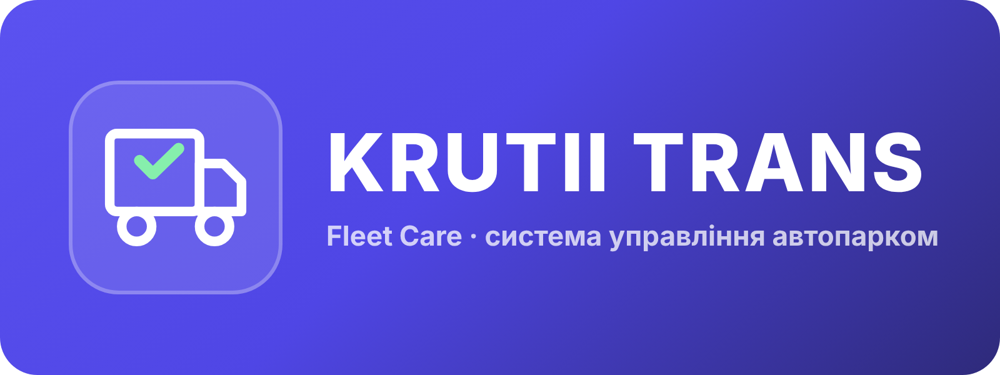
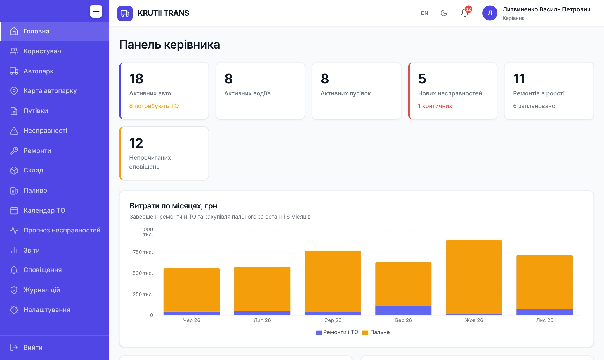
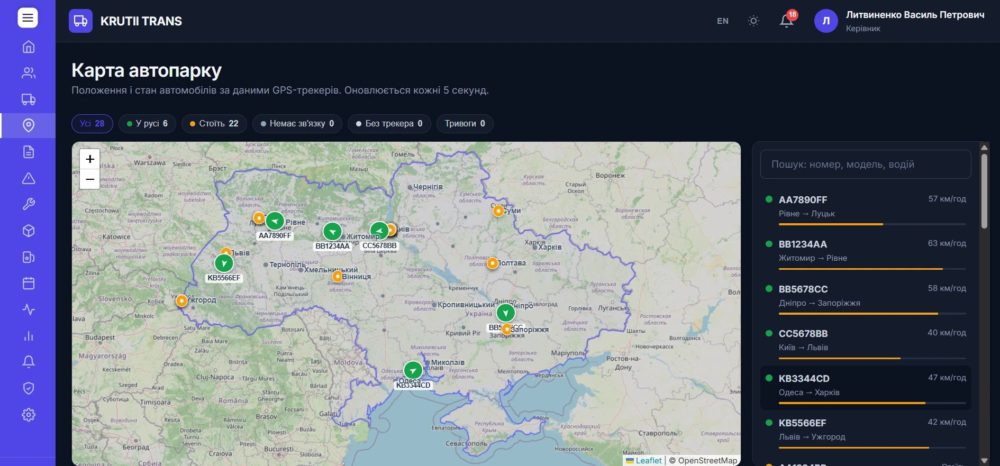
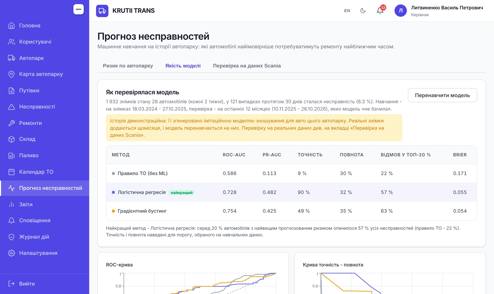
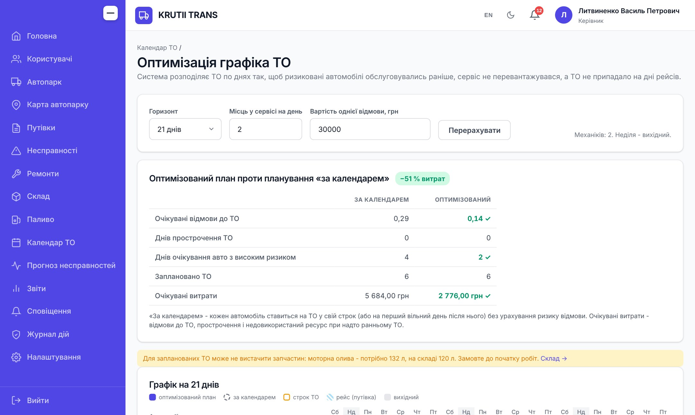
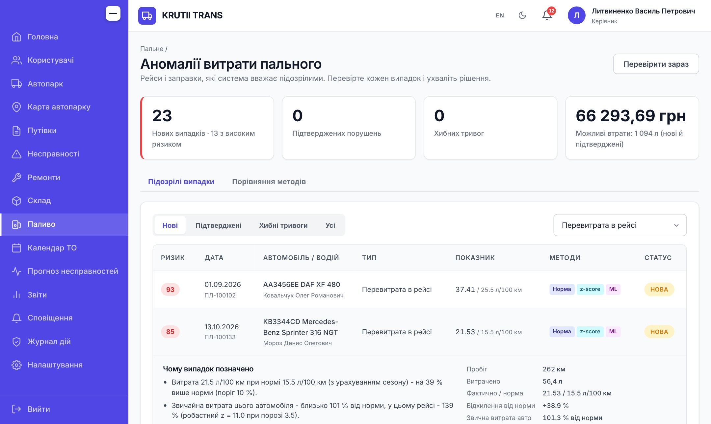

<p align="center">
  
</p>

# KRUTII TRANS

[](https://github.com/Otchak1Vitalik/Logistics_Fleet_Care/actions/workflows/tests.yml)

Система технічного обслуговування автопарку логістичної компанії.

Крім обліку путівок, пального, несправностей і ремонтів, система аналізує дані автопарку: виявляє підозрілу витрату пального, прогнозує несправності методами машинного навчання, оптимізує графік ТО та показує автомобілі на карті в реальному часі за даними GPS-трекерів (телематика).

<p align="center">
  
  
</p>

## Технології

- **Backend:** Flask, PyMongo, JWT, APScheduler, Marshmallow, Flask-Limiter
- **Аналітика та ML:** scikit-learn (Isolation Forest, логістична регресія, градієнтний бустинг), SciPy (угорський алгоритм), NumPy
- **Документи:** ReportLab (PDF-путівки з QR-кодом, шрифти DejaVu з кирилицею)
- **Frontend:** React 18, Zustand, Recharts, Vite, React Router, Leaflet + OpenStreetMap
- **Database:** MongoDB
- **Тести:** pytest (окрема тестова база `krutii_test`), GitHub Actions
- **Розгортання:** Docker, Docker Compose, nginx
- **UI:** Власна дизайн-система з glassmorphism ефектами, світла й темна тема, інтерфейс українською та англійською

## Можливості

### Керівник (Manager)
- Повне управління користувачами та автопарком
- Створення та контроль путівок, друк і завантаження путівки в PDF з QR-кодом
- Паливні накладні та аналітика витрат
- **Аномалії витрати пального:** підозрілі рейси й заправки, рішення «підтверджено / хибна тривога», порівняння методів виявлення
- **Прогноз несправностей (ML):** ризик відмови кожного авто на 30 днів, якість моделі, перевірка на реальних даних Scania
- **Оптимізація графіка ТО:** план обслуговування на 2-4 тижні з урахуванням ризику, рейсів і місткості сервісу
- **Карта автопарку:** положення, швидкість, пальне, температура двигуна й коди помилок у реальному часі
- **Журнал дій:** хто, коли і що змінив у системі, з експортом в Excel
- Звіти по витратах, ТО, ефективності; графіки на панелі керівника; експорт в Excel
- Склад запчастин: залишки, надходження, рух, сповіщення про мінімальний залишок
- Налаштування системи (норми пального, категорії)

### Механік (Mechanic)
- Обробка несправностей від водіїв
- Планування та виконання ремонтів зі списанням запчастин зі складу
- Контроль графіку технічного обслуговування, календар ТО
- Історія кожного автомобіля («медична карта»): путівки, несправності, ремонти, заправки
- Ризик несправності й прогнозна дата ТО в картці авто
- Карта автопарку й сигнали телематики (перегрів, напруга, коди помилок)
- Миттєві сповіщення про нові несправності

### Водій (Driver)
- Перегляд активних путівок, PDF-путівка для друку
- Звіти про несправності з фото
- Облік заправок на маршруті
- Завершення путівок з фіксацією пробігу

### Для всіх ролей
- Вхід за паролем або **за 4-значним кодом з пошти** (Gmail)
- Профіль: власні контакти й зміна пароля
- Перемикання мови (українська / англійська), зокрема на сторінці входу
- Світла й темна тема, бічне меню, що згортається
- Панель контактів компанії (соцмережі, пошта)

<p align="center">
  
  
</p>

## Встановлення

### Вимоги
- Python 3.11+
- Node.js 18+
- MongoDB 6+

### Швидкий старт (Windows)

Запустіть `start.bat` у папці `Krutii_Trans`. Скрипт перевірить MongoDB, створить віртуальне середовище, встановить залежності, за першого запуску заповнить базу демоданими й відкриє три вікна: **Backend**, **Frontend** і **Simulator**. У вікні Simulator натисніть `1`, щоб увімкнути симулятор телематики (машини на карті), або `2`, щоб закрити його.

### Docker (будь-яка ОС)

Потрібен лише [Docker Desktop](https://www.docker.com/products/docker-desktop/) - Python, Node.js і MongoDB встановлювати не треба. У папці `Krutii_Trans`:

```bash
docker compose up --build                       # база, бекенд і сайт
docker compose --profile simulator up --build   # те саме + симулятор телематики
```

Сайт: http://localhost:5173. За першого запуску база автоматично заповнюється демоданими. Зупинка - `Ctrl+C` або `docker compose down`; повністю скинути дані - `docker compose down -v`. Пароль пошти для входу за кодом береться з `backend/.env`, якщо файл існує.

### Backend

```bash
cd backend
python -m venv venv
venv\Scripts\activate  # Windows
source venv/bin/activate  # Linux/Mac
pip install -r requirements.txt
python seed.py  # Ініціалізація демо-даних
python app.py   # Сервер на http://localhost:5001
```

### Frontend

```bash
cd frontend
npm install
npm run dev
```

Додаток буде доступний на http://localhost:5173

### Вхід за кодом з пошти (необов'язково)

Щоб коди входу надходили на справжню пошту, скопіюйте `backend/.env.example` у `backend/.env` і вкажіть адресу Gmail та пароль застосунку (16 символів, створюється в налаштуваннях Google-акаунта з увімкненою двоетапною перевіркою). Без цього система працює в демо-режимі: код виводиться у вікні Backend. Файл `.env` у репозиторій не потрапляє.

### Симулятор телематики

Симулятор імітує GPS-трекери автопарку: автомобілі з активними путівками їдуть трасами України, заправляються, а час від часу трапляються несправності й порушення (перегрів, код помилки, розряд акумулятора, злив пального, рух без путівки). Запускається з `start.bat` або окремо, коли працює Backend:

```bash
cd backend
venv\Scripts\python.exe simulator.py                      # Windows
python simulator.py --incident-every 20                   # інциденти частіше (для демонстрації)
python simulator.py --no-incidents --speed 60             # без інцидентів, швидше
```

Справжній трекер підключається так само: керівник видає ключ на карті автопарку, а трекер надсилає дані на `POST /api/telematics/ingest` із заголовком `X-Device-Key`.

### Перевірка моделі на даних Scania (необов'язково)

Готовий звіт уже лежить у `backend/assets/ml/scania_report.json`. Щоб перерахувати його (скрипт завантажить набір даних ~56 МБ і працюватиме кілька хвилин):

```bash
cd backend
venv\Scripts\python.exe -m ml.scania_validate
```

## Демо-акаунти

| Роль | Логін | Пароль |
|------|-------|--------|
| Керівник | admin | Admin1234 |
| Механік | mech_koval | Mech1234 |
| Водій | driver_ivanov | Driver1234 |

## Структура проекту

```
/backend
  app.py              # Flask entry point
  config.py           # Конфігурація (MongoDB, JWT, rate limits, пошта)
  seed.py             # Демо-дані
  simulator.py        # Симулятор GPS-трекерів (телематика)
  Dockerfile, docker-entrypoint.py # Образ бекенду (автозаповнення демоданими)
  .env.example        # Зразок налаштувань пошти
  /routes             # API endpoints
    auth.py           # Авторизація (пароль, код з пошти, профіль)
    users.py          # Користувачі
    vehicles.py       # Автопарк
    waybills.py       # Путівки (+ PDF)
    faults.py         # Несправності
    repairs.py        # Ремонти
    fuel.py           # Паливо
    fuel_anomalies.py # Аномалії витрати пального
    parts.py          # Склад запчастин
    alerts.py         # Сповіщення
    reports.py        # Звіти, аналітика, календар ТО
    settings.py       # Налаштування
    audit.py          # Журнал дій
    predictive.py     # Прогноз несправностей (ML)
    maintenance_plan.py # Оптимізація графіка ТО
    telematics.py     # Телематика: прийом даних трекерів, карта
  /models             # Marshmallow schemas
  /services
    fuel_analyzer.py  # Аналіз перевитрат пального
    fuel_anomalies.py # Виявлення аномалій: правило, z-score, Isolation Forest
    alert_engine.py   # Система сповіщень, ескалації та фонові задачі
    doc_generator.py  # Генерація номерів документів
    maintenance_forecast.py   # Прогноз дати ТО за пробігом
    predictive_maintenance.py # ML-модель ризику несправності
    ml_metrics.py     # Метрики якості моделей
    maintenance_optimizer.py  # Оптимізація графіка ТО (угорський алгоритм)
    telematics.py     # Правила телематики
    geo_ukraine.py    # Міста й траси України для маршрутів
    waybill_pdf.py    # PDF-путівка
    audit.py          # Запис журналу дій
    inventory.py      # Рух запчастин на складі
    login_codes.py, mailer.py # Коди входу й надсилання листів
  /ml
    scania_validate.py # Перевірка методів на наборі Scania APS
  /assets             # Шрифти для PDF, звіт Scania
  /middleware
    auth_middleware.py # JWT авторизація та ролі
  /tests              # Автоматизовані тести (pytest)

/frontend/src
  /api                # Axios клієнти з interceptors
  /store              # Zustand stores (auth, alerts, theme, sidebar)
  /layouts            # Layouts по ролям
  /i18n               # Переклад інтерфейсу (українська / англійська)
  /pages
    /driver           # Сторінки водія
    /mechanic         # Сторінки механіка
    /manager          # Сторінки керівника
    /shared           # Спільні сторінки (карта автопарку, календар ТО, склад)
  /components         # UI компоненти (DataTable, StatusBadge, AlertBell, SideBar)
  /utils              # Форматери, калькулятори, експорт в Excel
  /styles             # CSS з дизайн-системою

/docs                 # Логотипи та скриншоти
docker-compose.yml    # Запуск усієї системи в Docker
/frontend/Dockerfile, nginx.conf # Образ сайту (nginx)
```

## Ключові особливості

### Аутентифікація
- JWT токени в httpOnly cookies
- Автоматичний refresh при закінченні сесії
- Rate limiting на логін (10 req/min) і на запит коду з пошти (5 req/min)
- Вхід за кодом з пошти: код діє 5 хвилин, не більше 5 спроб, повторне надсилання - через 30 секунд
- 5 невдалих спроб входу за 15 хвилин - критичне сповіщення керівнику

### Формула витрат пального
```
fuel_recommended = (distance_km / 100) * fuel_norm * season_coefficient
season_coefficient = 1.0 (літо) | 1.09 (зима: листопад-березень)
```

### Система сповіщень
- Ескалація несправностей: 4 години - механіку, 24 години - керівнику
- Попередження про ТО: за 1000 км або 14 днів
- Мінімальний залишок запчастин на складі
- Підозріла витрата пального (щодня о 8:10 і після кожної завершеної путівки)
- Високий ризик несправності за ML-прогнозом (щодня о 8:20)
- Події телематики: перегрів двигуна, низька напруга, коди помилок, злив пального, рух без путівки
- Push-сповіщення в реальному часі

### Нумерація документів
- ПЛ-XXXXXX - путівки
- НС-XXXXXX - несправності
- РМ-XXXXXX - ремонти
- НП-XXXXXX - паливні накладні

### Журнал дій
- Автоматично фіксується кожна зміна даних: хто, коли, з якої адреси і що саме змінилося («було → стало»)
- Записи не можна змінити чи видалити через API; зберігаються 365 днів
- Фільтри за користувачем, категорією, статусом і датами, експорт в Excel

### PDF-путівка
- Путівка формується на сервері (ReportLab) у форматі А4 з QR-кодом
- QR-код веде на сторінку путівки в системі (`/w/<id>`)
- Друк і завантаження з анімацією; часи - у місцевому часовому поясі

### Аномалії витрати пального
Кожен завершений рейс перевіряється трьома методами, а заправки - формальними правилами:
- **правило норми** - перевищення норми з урахуванням сезону більше за поріг з налаштувань;
- **робастний z-score** (медіана й MAD, поріг 3.5) - нетипово висока витрата відносно звичної для цього авто;
- **Isolation Forest** - нетиповий рейс за сукупністю ознак;
- **заправки** - обсяг понад бак, повторна заправка майже без пробігу, нетипова ціна;
- **телематика** - різке падіння рівня пального на стоянці (злив).

Керівник позначає випадки як «підтверджено» або «хибна тривога»; ці рішення використовуються для оцінки точності методів. На демоданих (220 рейсів, 15 відомих порушень):

| Метод | Точність | Повнота | F1 |
|-------|----------|---------|----|
| Правило норми | 86 % | 80 % | 0.83 |
| Статистика (z-score) | 100 % | 73 % | 0.85 |
| Isolation Forest | 75 % | 100 % | 0.86 |
| **Будь-який метод (система)** | **88 %** | **100 %** | **0.94** |

### Прогноз несправностей (ML)
- Для кожного автомобіля обчислюється ймовірність несправності протягом 30 днів за ознаками: вік, пробіг, використана частка інтервалу ТО, дні після ТО, добовий пробіг, нещодавні несправності й ремонти, відхилення витрати пального
- Порівнюються три методи: правило ТО (без ML), логістична регресія і градієнтний бустинг; перевірка - на останніх 12 місяцях, яких модель не бачила під час навчання
- Для кожного авто показуються основні чинники ризику й рекомендація; сигнали телематики (перегрів, коди помилок) додаються окремо
- Модель донавчається на реальних знімках стану автопарку, які зберігаються щомісяця

На історії демо-автопарку (синтетична історія, 1932 знімки):

| Метод | ROC-AUC | PR-AUC | Відмов серед 20 % найризикованіших |
|-------|---------|--------|-------------------------------------|
| Правило ТО (без ML) | 0.59 | 0.11 | 22 % |
| **Логістична регресія** | **0.73** | **0.48** | **57 %** |
| Градієнтний бустинг | 0.75 | 0.43 | 63 % |

Перевірка тих самих методів на реальному наборі **APS Failure at Scania Trucks** (60 000 записів для навчання, 16 000 для перевірки; вартість помилок за умовою Scania: зайвий огляд - 10, пропущена відмова - 500):

| Метод | ROC-AUC | Пропущено відмов (з 375) | Вартість помилок |
|-------|---------|--------------------------|------------------|
| Без моделі | - | 375 | 187 500 |
| Правило за одним показником | 0.974 | 22 | 19 700 |
| Логістична регресія | 0.992 | 14 | 14 220 |
| **Градієнтний бустинг** | **0.993** | **11** | **10 980 (−94 %)** |

### Оптимізація графіка ТО
ТО розподіляється по днях горизонту (14, 21 або 28 днів) як задача про призначення, яка розв'язується точно угорським алгоритмом:

```
вартість(авто, день) = P(відмова до ТО) × вартість відмови
                     + недовикористаний ресурс при надто ранньому ТО
                     + штраф за кожен день прострочення
```

Обмеження: кількість місць у сервісі на день, вихідні, дні рейсів автомобіля. Результат порівнюється з плануванням «за календарем»; на демоданих оптимізований план зменшує очікувані відмови з 0.29 до 0.10 і витрати на 72 % без жодного дня прострочення. Також перевіряється, чи вистачить на складі фільтрів і оливи. Затверджений план створює заплановані ТО в розділі «Ремонти».

### Телематика
- Трекер надсилає координати, швидкість, одометр, рівень пального, температуру двигуна, напругу, оберти та коди помилок OBD; у базі зберігається лише хеш ключа пристрою
- Сирі дані зберігаються 90 днів; одометр автомобіля оновлюється автоматично
- Правила: перегрів ≥ 105 °C, напруга нижче 23 В (вантажівки) / 11.6 В (легкові), новий код помилки, злив пального на стоянці, рух без активної путівки; сповіщення одного типу - не частіше ніж раз на 2 години
- Маршрут путівки будується трасами України між містами (алгоритм Дейкстри); контур України на карті видно навіть без інтернету

<p align="center">
  
</p>

## API Endpoints

### Авторизація
- `POST /api/auth/login` - Вхід
- `POST /api/auth/email-code/request` - Надіслати код входу на пошту
- `POST /api/auth/email-code/verify` - Вхід за кодом
- `POST /api/auth/logout` - Вихід
- `GET /api/auth/me` - Поточний користувач
- `PUT /api/auth/me` - Зміна власних контактів
- `POST /api/auth/change-password` - Зміна пароля

### Ресурси
- `GET/POST /api/users` - Користувачі
- `GET/POST /api/vehicles` - Автопарк
- `GET /api/vehicles/<id>/history` - Історія автомобіля й прогноз ТО
- `GET/POST /api/waybills` - Путівки
- `GET /api/waybills/<id>/pdf` - PDF-путівка (`?download=1` - завантаження)
- `GET/POST /api/faults` - Несправності
- `GET/POST /api/repairs` - Ремонти
- `GET/POST /api/fuel/invoices` - Паливні накладні
- `GET/POST /api/fuel/records` - Видача та заправки
- `GET/POST /api/parts` - Склад запчастин
- `GET /api/alerts` - Сповіщення
- `GET /api/audit` - Журнал дій

### Звіти
- `GET /api/reports/fuel-consumption` - Звіт по пальному
- `GET /api/reports/maintenance-schedule` - Графік ТО
- `GET /api/reports/driver-performance` - Ефективність водіїв
- `GET /api/reports/costs-summary` - Витрати
- `GET /api/reports/analytics` - Дані для графіків
- `GET /api/reports/maintenance-calendar` - Календар ТО

### Аналітика
- `GET /api/fuel/anomalies` - Аномалії пального; `PUT /api/fuel/anomalies/<id>` - рішення; `GET /api/fuel/anomalies/evaluation` - порівняння методів
- `GET /api/predictive/risk` - Ризик несправності по автопарку
- `GET /api/predictive/model` - Якість моделі; `POST /api/predictive/retrain` - перенавчання
- `GET /api/predictive/scania` - Результати перевірки на даних Scania
- `GET /api/maintenance-plan` - Оптимізований графік ТО; `POST /api/maintenance-plan/apply` - затвердження

### Телематика
- `POST /api/telematics/ingest` - Дані від трекера (заголовок `X-Device-Key`)
- `GET /api/telematics/fleet` - Стан автопарку для карти
- `GET /api/telematics/vehicle/<id>` - Трек і графіки автомобіля
- `POST /api/telematics/devices/<vehicle_id>` - Видати ключ трекера

## Статуси

| Сутність | Статуси |
|----------|---------|
| Путівки | issued -> active -> completed / cancelled |
| Ремонти | planned -> in_progress -> completed / cancelled |
| Несправності | new -> acknowledged -> in_repair -> resolved / rejected |
| Транспорт | active / repair / inspection / decommissioned |
| Аномалії пального | new -> confirmed / dismissed |

## Тести

```bash
cd backend
venv\Scripts\python.exe -m pytest -q
```

90 автоматизованих тестів (авторизація і вхід за кодом, ескалації, цикл «несправність → ремонт», пальне, склад, журнал дій, PDF, аномалії пального, ML-прогноз, оптимізація ТО, телематика). Тести працюють з окремою базою `krutii_test`, яка очищується перед кожним тестом. На GitHub тести, збірка сайту й Docker-образів запускаються автоматично при кожному push (GitHub Actions, `.github/workflows/tests.yml`).

## Джерела даних і ліцензії

- Шрифти DejaVu (PDF) - вільна ліцензія, див. `backend/assets/fonts/LICENSE-DejaVu.txt`
- Карта - © учасники OpenStreetMap; контур України - Natural Earth (суспільне надбання)
- Набір «APS Failure at Scania Trucks» - Scania CV AB, UCI Machine Learning Repository (GPL-3); у репозиторій не входить, завантажується скриптом перевірки
