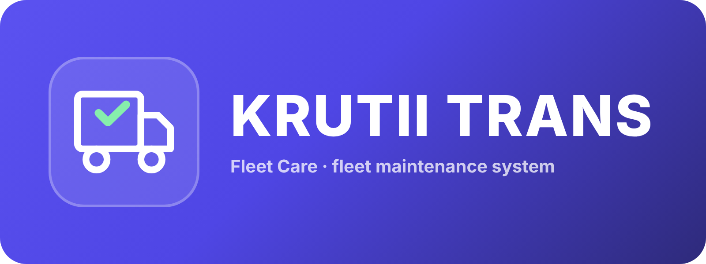
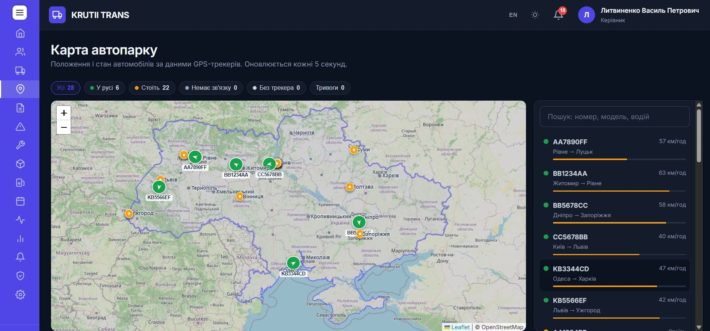
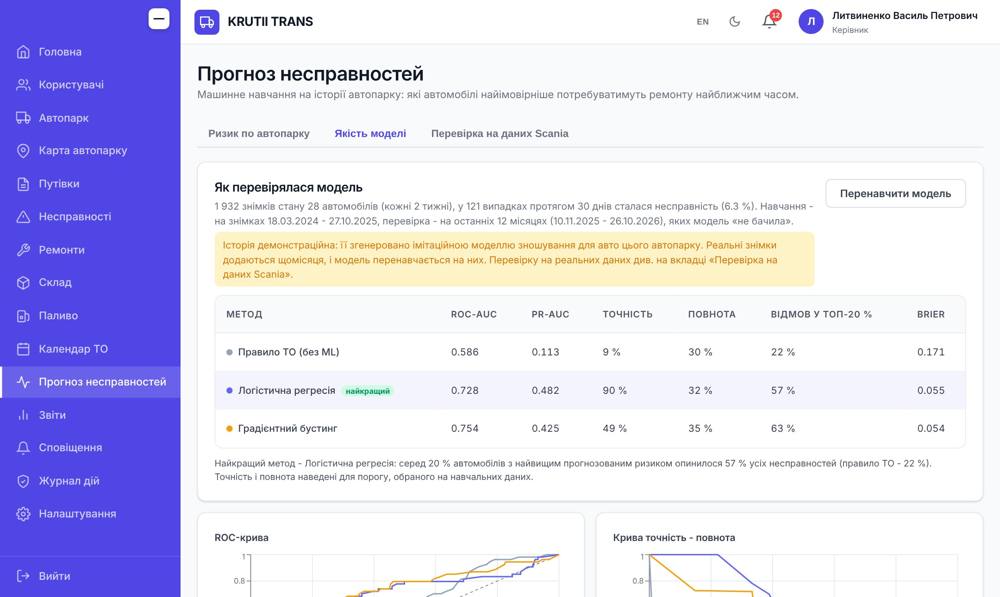

<p align="center">
  
</p>

# KRUTII TRANS

Автоматизована система управління технічним обслуговуванням автомобілів логістичної компанії.<br>
*Automated vehicle maintenance management system for a logistics company.*

📘 [Документація українською](Krutii_Trans/README_UKR.md) · 📗 [Documentation in English](Krutii_Trans/README_ENG.md)

<p align="center">
  
  
</p>

## Можливості · *Features*

- 🚚 **Автопарк, путівки, пальне, несправності, ремонти, склад запчастин** — три ролі: керівник, механік, водій<br>
  *Fleet, waybills, fuel, faults, repairs and parts warehouse — three roles: manager, mechanic, driver*
- 🛰 **Телематика:** карта автопарку в реальному часі, перегрів, коди помилок, злив пального, рух без путівки<br>
  *Telematics: live fleet map, overheating, error codes, fuel drains, driving without a waybill*
- 🤖 **Прогноз несправностей (ML)** з перевіркою на реальних даних Scania APS<br>
  *Failure prediction (ML) validated on real Scania APS data*
- 📅 **Оптимізація графіка ТО** — задача про призначення (угорський алгоритм)<br>
  *Maintenance schedule optimization — assignment problem (Hungarian algorithm)*
- ⛽ **Аномалії витрати пального** — правило норми, z-score, Isolation Forest<br>
  *Fuel consumption anomalies — norm rule, z-score, Isolation Forest*
- 📄 **PDF-путівки з QR-кодом**, журнал дій, вхід за кодом з пошти, експорт в Excel, українська та англійська мови<br>
  *PDF waybills with a QR code, activity log, email code sign-in, Excel export, Ukrainian and English*

**Stack:** Flask · MongoDB · scikit-learn · React 18 · Vite · Recharts · Leaflet

## Швидкий старт · *Quick start*

Потрібні: Python 3.11+, Node.js 18+, MongoDB 6+<br>
*Requires: Python 3.11+, Node.js 18+, MongoDB 6+*

**Windows:** запустіть `Krutii_Trans\start.bat`, потім відкрийте http://localhost:5173<br>
*Windows: run `Krutii_Trans\start.bat`, then open http://localhost:5173*

Демо-вхід: `admin` / `Admin1234`<br>
*Demo sign-in: `admin` / `Admin1234`*

## Структура · *Structure*

```
Krutii_Trans/
  backend/    Flask API, ML, simulator, tests
  frontend/   React application
  docs/       logos and screenshots
  start.bat   one-click start (Windows)
```

Детальний опис, встановлення вручну, API та результати моделей — у документації.<br>
*Detailed description, manual installation, API and model results — in the documentation.*
